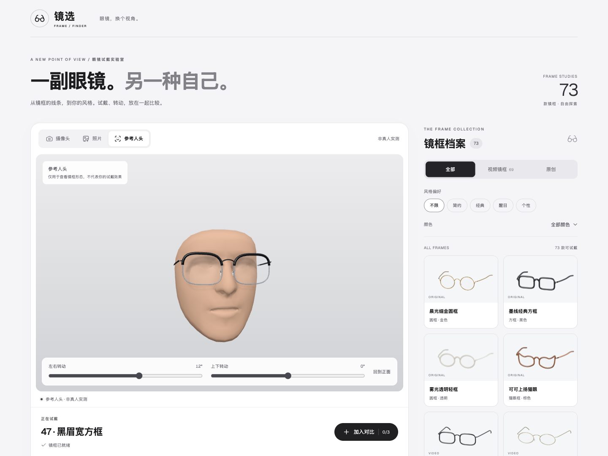

# 镜选 · Eyewear Assistant

在浏览器里换一副眼镜，再把几种试戴效果放在一起比较。

[在线体验](https://e.ilove-gis.com/) · [代码仓库](https://github.com/abining/eyewear-assistant)



## 能做什么

- 开启摄像头，让镜框跟随人脸；也可以使用本地照片或参考人头。
- 从 73 款模型里选框，按风格、颜色筛选，查看基于镜框属性的推荐理由。
- 调整镜框大小和上下位置，设置在当前浏览器记忆。
- 保存最多三张试戴快照并排比较。照片模式使用同一底图；摄像头快照摄于不同时间。
- 导入自己的 GLB 镜框。

参考人头可直接体验，摄像头需要 HTTPS 或 localhost 和浏览器授权。首次真人试戴需要加载追踪引擎与人脸模型，实际等待时间受网络和设备影响。快照只保留在当前页面，刷新后清除。

这是视觉试戴预览，不用于验光、瞳距或实物尺寸测量。推荐理由来自已标注属性，不是颜值评分。模型也不是在售商品目录。

## 本地运行

需要 Node.js 和 pnpm。

```sh
pnpm install --frozen-lockfile
pnpm dev:https
```

打开 `https://localhost:5178/`。开发服务监听 `0.0.0.0:5178`，使用自签名证书；局域网设备也可通过本机 IP 访问。若安装时禁用了脚本，先执行 `pnpm prepare:models` 准备追踪资源。

```sh
pnpm test
pnpm build
```

构建仅执行 Vite 打包，不运行类型检查或格式化。自动测试覆盖初始化、重试、取消/销毁、快照合成、偏好筛选和比例校准等行为；WebGL、摄像头与真实设备表现仍需浏览器验证。

## 镜框与生成方式

模型库共 73 款，使用 AI 辅助编写的参数化脚本在本地生成，没有使用付费图生 3D 服务。可见轮廓、颜色和框形用于外观参考；镜腿、曲率和尺寸属于示意，不代表官方合作或精确商品复刻。

| 文件 | 用途 |
| --- | --- |
| `public/models/` | 网页使用的 GLB、目录清单与 WebP 缩略图 |
| `scripts/generate-frame-assets.mjs` | 几何示例生成器 |
| `scripts/generate-tim-frames.py` | 视频外观模型生成器 |
| `assets/tim-frames/catalog.json` | 可编辑外观参数 |
| `assets/tim-frames/coverage.json` | 参考帧与模型的对应记录 |
| `assets/tim-frames/finish-previews.py` | 缩略图压缩和目录更新 |

重新生成需要 Blender，以及安装 Pillow 的 Python 3：

```sh
pnpm generate:frames
pnpm generate:tim
node assets/tim-frames/validate-models.mjs
```

生成过程会在本机产出 `.blend` 源文件与 PNG 中间文件，它们不需要提交即可由脚本重建。原视频、人脸截图及私人试戴照片不放入此仓库。

自定义 GLB 使用米为单位、Y 轴向上、正面朝 +Z、鼻梁中心为原点；独立镜腿命名 `temple_left` / `temple_right`，镜片名称以 `lens` 开头。

## 部署

正式站点采用 Cloudflare Workers Static Assets，页面、镜框和追踪资源由同源 CDN 提供；没有动态 Worker、数据库、R2 或服务器推理。

```sh
pnpm deploy:cloudflare
```

部署前登录自己的 Cloudflare 账号，并把 `wrangler.jsonc` 中的账号、项目名和域名改成自己的配置。命令会准备构建并上传静态资源。

缓存规则由 `public/_headers` 定义；追踪资源的生成和地址由 `scripts/copy-mediapipe.mjs` 管理。更新资源时通过版本化 URL 失效旧缓存，HTML 和模型目录保持可更新。静态部署无需新增付费服务，已有域名和账号的成本另计。

## 许可与边界

本项目自有新增代码、文档及拥有权利的资源按 [PolyForm Noncommercial 1.0.0](LICENSE) 许可，仅限非商业用途，不允许商业应用；商业使用须事先取得权利人的单独书面授权。第三方代码、模型、字体等按各自原许可使用，见 [第三方许可声明](THIRD_PARTY_NOTICES.md)，非商业条款不限制第三方的原有权利，历史版本已授予的许可不追溯改变。

欢迎报告无法加载、跟踪偏移或模型连接等问题，并注明浏览器、设备和复现步骤。请勿在公开 issue 中附上未经同意的人脸照片。
